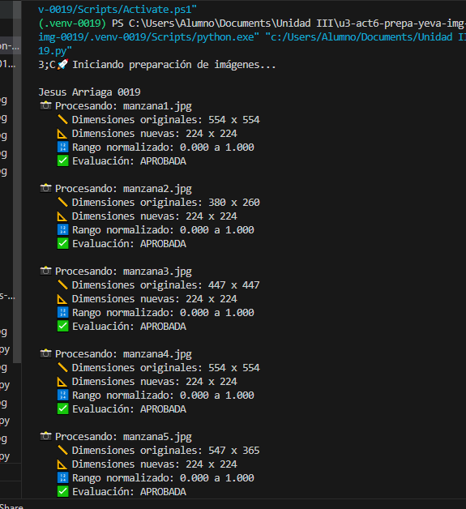
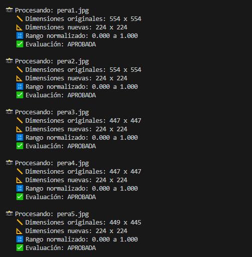
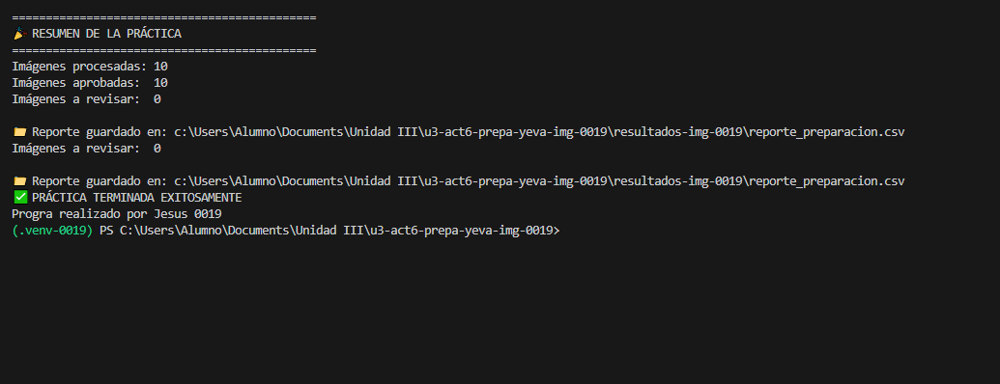
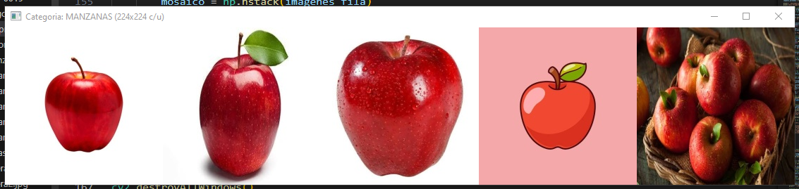
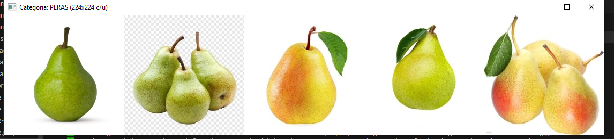

## Jesus Arriaga 0019
# 🚀 Práctica Guiada: Preparación y Evaluación de Imágenes para Visión Artificial

> **Nivel:** Básico – Principiante (Desde cero)  
> **Duración:** 2 horas  
> **Asignatura:** Soluciona problemas de Visión Artificial  
> **Especialidad:** Inteligencia Artificial  
> **Semestre:** 3º de Preparatoria  
> **Herramientas:** Python, Visual Studio Code, OpenCV y NumPy.
## 🎯 1. Propósito de la Práctica
## El objetivo es que comprendas **cómo preparar un conjunto de imágenes** antes de alimentarlas a un modelo de Inteligencia Artificial. Al final, serás capaz de:

- ✅ Identificar el tamaño y formato de las imágenes.
- ✅ Organizar imágenes en carpetas por categoría.
- ✅ Cambiar el tamaño de las imágenes a dimensiones uniformes.
- ✅ Convertir imágenes a un formato común.
- ✅ Normalizar los valores de los píxeles (¡la comida favorita de la IA!).
- ✅ Evaluar que las imágenes procesadas cumplan con los criterios establecidos.

**📦 Producto esperado:** Un conjunto de imágenes organizado, redimensionado, convertido y normalizado, acompañado de un reporte automático generado con Python.
## Resultados manzana 

## Resultados peras 

## Resumen de la practica 

## IMG preparadas manzanas 

## IMG preparadas peras 
